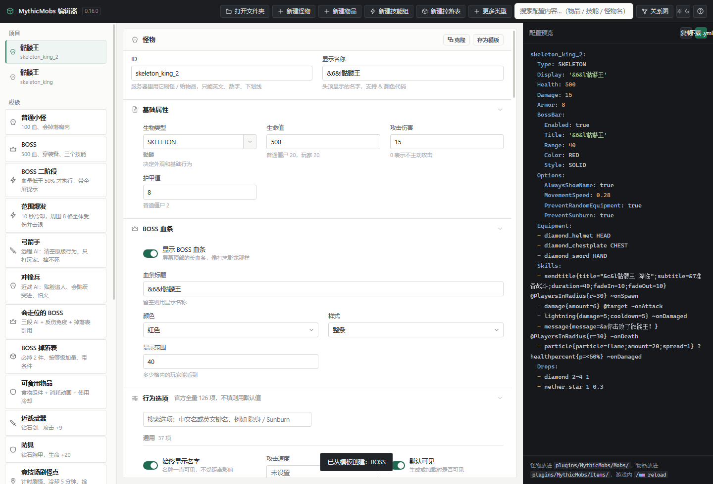
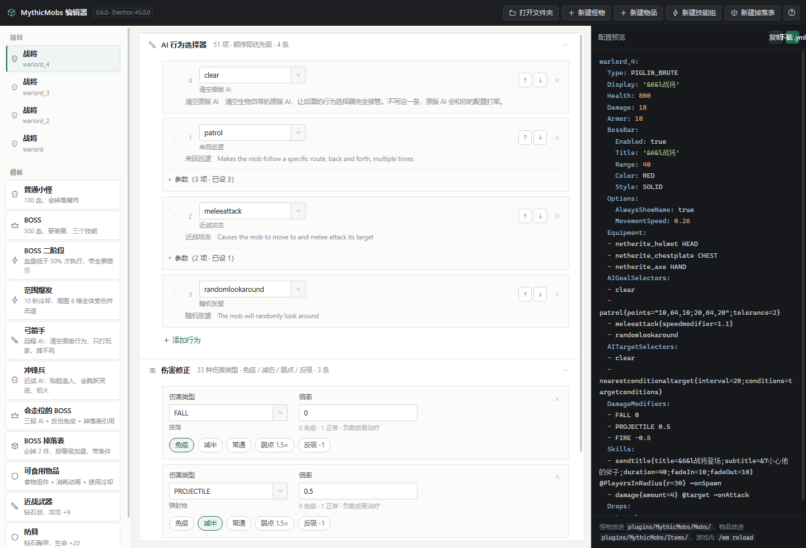
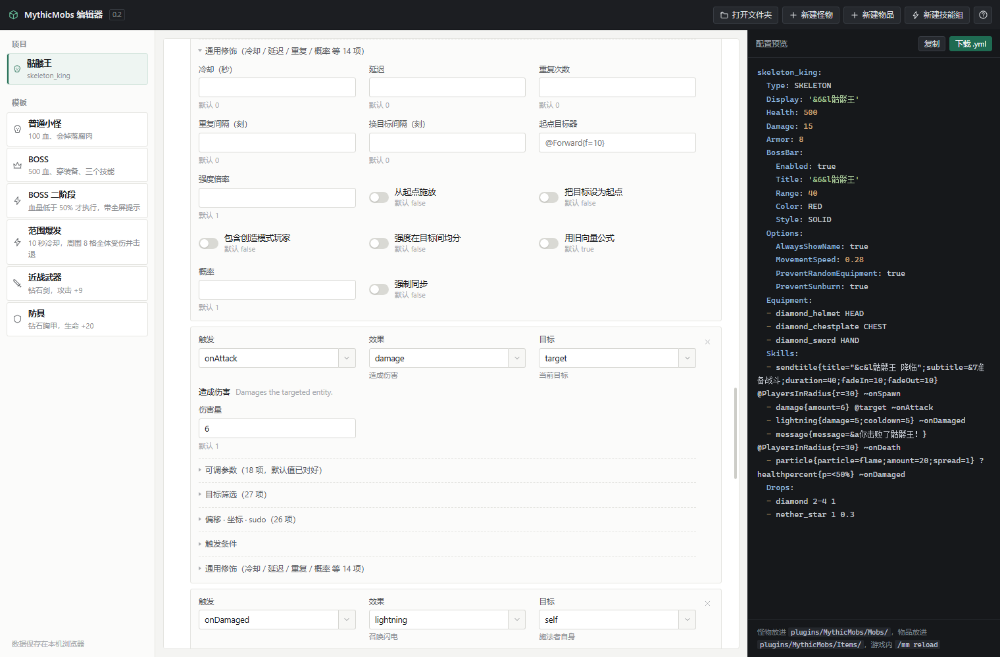
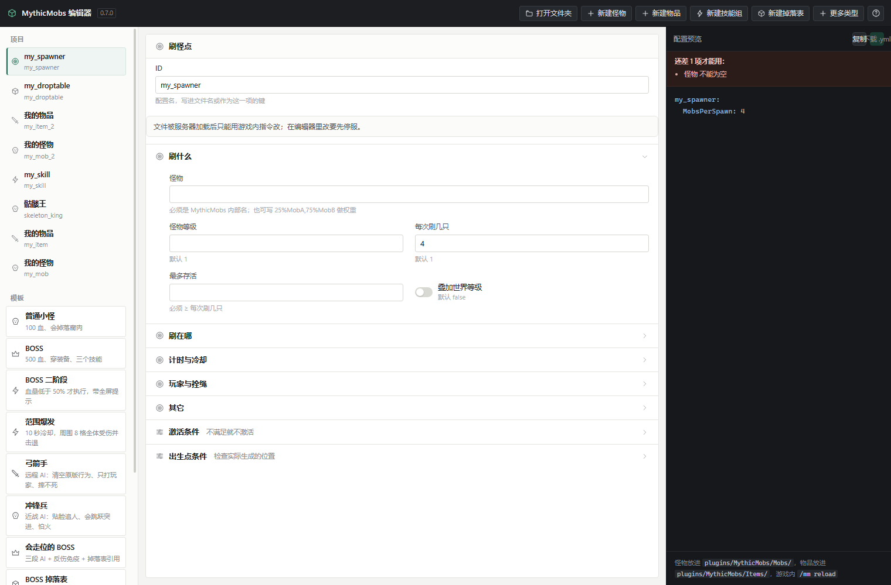
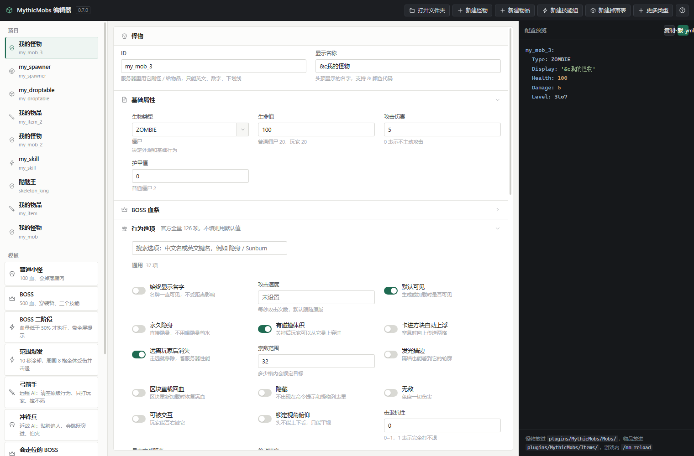
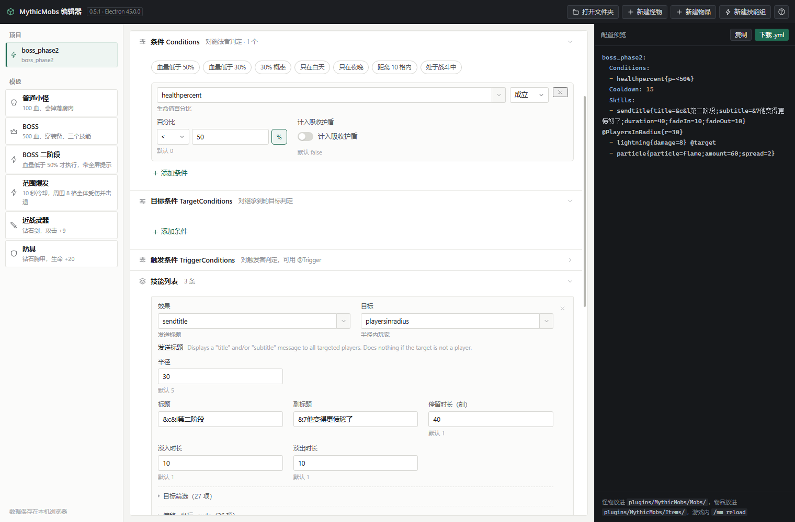
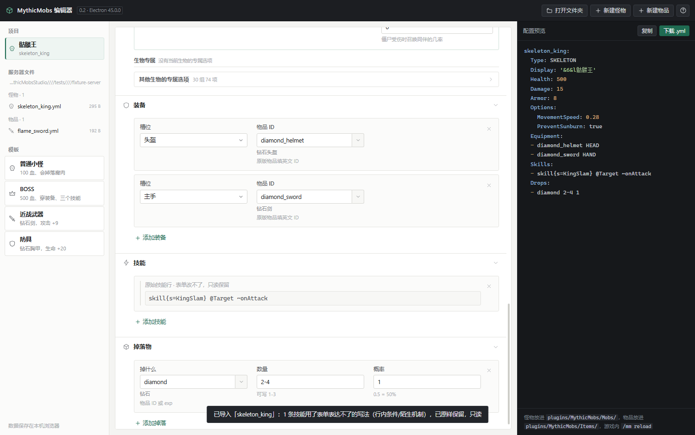

# MythicMobs Studio


一个给「不会写 YAML 的人」用的 MythicMobs 可视化编辑器。

当前状态：**0.9.0** —— 怪物 / 物品 / 技能组 / **掉落表**四类配置的表单编辑、实时生成配置、**导入服务器上已有的 yml 改完写回**都已跑通；wiki 的 **302 机制 / 196 条件 / 91 目标器 / 38 触发器 / 120 粒子 / 51 AI 行为 / 14 AI 目标** 已全部接进界面并中文化。

0.7.0 把 wiki 上剩下没做的功能**全部补齐**了：新增**通用字段引擎**，一次描述字段树就同时拿到界面、YAML 生成和导入反向映射，于是又多了 **9 种配置类型**（刷怪点 / 随机刷怪 / 自定义属性 / 菜单 / 对话 / 过场镜头 / 定位点 / 内容包 / 原版覆写）、怪物的 **17 个顶层字段**（等级成长、阵营伪装、血条、仇恨表、村民交易、图腾、模块开关…），物品 58 项组件里有表单的也从 23 项涨到 **51 项**，外加掉落特效（FancyDrops）。

0.8.0 做的是**易用性三件套**：引用检查从「一行蓝字」变成**可点击**（不存在的名字一键新建，已存在的引用一键跳到那个文件）；导入过的项目可以**一键从磁盘重新读取**（外部改过文件后不用重新导入）；一个文件里有多个条目的（比如 `pins.yml`）可以在条目之间**直接切换编辑**，不用再拆文件。

0.9.0 补上**打包发布**：`npm run dist` 出 Windows 便携版单文件 exe，双击即用，不用装 Node 或运行时。

0.10.0 加了两个实用小件：掉落表编辑器里多了**概率模拟**（按当前配置抽 100 / 1000 / 10000 次，直接看出货次数、实测概率与期望件数，独立判定和权重两种模式都会算）；**9 种新配置类型各配了一个模板**（竞技场刷怪点 / 夜晚荒野随机刷 / 暴击属性 / 简单主菜单 / NPC 对话 / BOSS 登场镜头 / 竞技场定位点 / 示例内容包 / 强化原版僵尸），新建不再从空白开始。



## 怎么用

1. 双击 **`dist/MythicMobsStudio-0.10.0.exe`**（打包好的便携版，什么都不用装）；
   或开发方式：双击 **`启动编辑器(无窗口).vbs`**（推荐，不会有黑框）或 **`启动编辑器.bat`**，打开独立窗口。
   没装 Electron 运行时会自动回落到浏览器（功能少掉文件读写）；`.bat` 会显示提示，`.vbs` 不会。
2. 左边挑一个模板，或点右上角「新建怪物 / 新建物品 / 新建技能组 / 新建掉落表」；
   再右边的「更多类型」下拉里还有刷怪点、随机刷怪、自定义属性、菜单、对话、过场镜头、定位点、内容包、原版覆写。
3. 中间填表格，右侧实时显示生成的配置。
4. 点「下载 .yml」，把文件放进服务器：
   - 怪物 → `plugins/MythicMobs/Mobs/`
   - 物品 → `plugins/MythicMobs/Items/`
   - 技能组 → `plugins/MythicMobs/Skills/`
   - 掉落表 → `plugins/MythicMobs/Drops/`
   - 刷怪点 → `plugins/MythicMobs/Spawners/`
   - 随机刷怪 → `plugins/MythicMobs/RandomSpawns/`
   - 自定义属性 → `plugins/MythicMobs/stats/`
   - 菜单 → `plugins/MythicMobs/menus/`
   - 对话 → `plugins/MythicMobs/dialogs/`
   - 过场镜头 → `plugins/MythicMobs/cutscenes/`
   - 定位点 → `plugins/MythicMobs/pins.yml`（整份文件是一个列表）
   - 内容包 → `plugins/MythicMobs/pack.yml`（整份文件没有外层 ID）
   - 原版覆写 → `plugins/MythicMobs/VanillaMobs/`
5. 游戏里 `/mm reload`。

数据存在浏览器本地（localStorage），关掉再打开还在；换电脑请用「下载 .yml」或重新填。

## MVP 现在能做什么

**怪物**
- 生物类型（可搜索下拉，78 种常见实体）、显示名、生命、伤害、护甲
- **126 个官方 Options 全部实现**（通用 37 / 生物大类 15 / 生物专属 74），每个都有中文名 + 一句话说明；顶部可搜索，当前生物的专属选项会自动展开，其余折叠
- **AI 行为选择器（51 项）与 AI 目标选择器（14 项）**：都带中文名 + 英文 ID + 一句话说明，参数只写与默认值不同的；**拖拽排序**（也可以 Alt+↑/↓，或用行尾的上下移按钮），原来的优先级数字（`- 0 clear`）原样保留
- **伤害修正（33 种伤害类型）**：一键「免疫 / 减半 / 常通 / 弱点 1.5× / 反吸 -1」，倍率语义直接写在输入框旁边（`0` 免疫但有受伤动画、`<0` 取消伤害并按绝对值回血）
- **等级 / 外观 / 模块（17 个顶层字段）**：等级与成长 —— `Level`（可写 `3to7` / `3-7` 表示每次生成随机）、`LevelModifiers`（每级成长）、`Template`（继承模板）；外观 —— `Faction` 阵营、`Disguise` 伪装、`KillMessages`、`HealthBar`、`Nameplate`、`DisplayOptions`、`MannequinOptions`（模特）；行为与模块 —— `Mount` 默认坐骑、`Modules` 模块开关、`Hearing` 听觉、`AIPathfindingMalus` 寻路惩罚、`Variables` 初始变量、`Trades` 村民交易、`Totem` 图腾召唤；空值整行不写，导进来的陌生字段原样保留
- BOSS 血条（标题 / 颜色 / 分段样式 / 显示范围）
- 装备（6 个槽位，物品中文下拉）
- 技能：**38 种触发器 × 302 种机制 × 91 种目标器 × 196 种条件**（wiki 全量），机制按用途分 11 组，下拉可搜索；参数按类型自动出控件，默认值不写进配置
- **行内条件**：点一下「血量低于 50%」「30% 概率」「只在夜晚」「距离 10 格内」就能加，也能自己挑 196 种条件里的任意一个
- **比较符下拉**：条件参数用「`=` `<` `≤` `>` `≥` `≠` + 数值 + `%`」三段式输入，不用背 `<50%` 的写法
- **目标筛选**：目标器自己的参数之外，还有 27 项通用筛选（`targetplayers` / `sort` / `limit` / `ignore`…）与 26 项偏移坐标，都写进 `@Targeter{}` 里
- **通用修饰**：14 项（冷却 / 延迟 / 重复次数 / 重复间隔 / 换目标间隔 / 概率 / 起点目标器 / 强度倍率 / 从起点施放 / 强制同步…），写在机制花括号里
- 掉落物：三种形态一键切换 —— **物品**（数量范围 / 概率 / 行内 `{name=..;color=..}` 参数）、**掉落类型**（`exp` / `money` / `cmd` / `mythicitem` 等 16 种，`cmd` 的命令原样写在花括号里）、**引用掉落表**（`table:boss_loot`）





**掉落表（DropTable，独立文件）**
- `TotalItems` / `MinItems` / `MaxItems` / `BonusLevelItems` / `BonusLuckItems` / `BiasStat` 全量字段；数字保持数字类型（写成 `'2'` 服务端会当字符串读）
- `Conditions`（判掉落者）/ `TriggerConditions`（判击杀者）两块条件
- 掉落列表与怪物那边共用同一套三形态编辑器，所以掉落表里也能再引用别的掉落表
- **掉落特效（FancyDrops）**：掉落物的模型 / 光效 / 缩放 / 旋转 / 悬浮高度 / 亮度，写在 `DropOptions` 里；不填就不写这一行

**技能组（Metaskill）**
- 技能组名 + 冷却 + `CancelIfNoTargets` / `Hidden`
- **三块独立条件**：`Conditions`（判施法者）/ `TargetConditions`（判继承到的目标）/ `TriggerConditions`（判触发者），每条可标「成立 / 不成立」（写 `false` 后缀）
- 技能列表复用怪物编辑器那套（机制 / 目标器 / 条件 / 通用修饰），只是不带触发器
- 条件不满足 / 冷却中 / 并发执行时改跑别的技能组（`FailedConditionsSkill` / `OnCooldownSkill` / `Skill`）

**其余 9 种配置类型（0.7.0）**

顶栏「更多类型」下拉里可以新建；桌面版扫目录时会按目录自动归组：

| 类型 | 放在哪 | 字段数 | 说明 |
|---|---|---:|---|
| 刷怪点 Spawner | `Spawners/` | 26 | 刷什么怪、刷在哪、冷却预热、要不要玩家在附近、拴绳距离、激活条件 |
| 随机刷怪 RandomSpawn | `RandomSpawns/` | 14 | 按世界 / 生物群系随机刷怪 |
| 自定义属性 Stat | `stats/` | 19 | 自定义属性与显示格式 |
| 菜单 Menu | `menus/` | 5 | 自定义菜单 |
| 对话 Dialog | `dialogs/` | 9 | NPC 对话窗口 |
| 过场镜头 Cinematic | `cutscenes/` | 4 | 镜头路径与时间点 |
| 定位点 Pin | `pins.yml` | 5 | 整份文件是一个列表，供 pin 相关机制与目标器使用 |
| 内容包 Pack | `pack.yml` | 10 | 包名 / 版本 / 作者 / 依赖与覆写，整份文件没有外层 ID |
| 原版覆写 VanillaOverride | `VanillaMobs/` | 11 | 给原版生物套 MythicMobs 配置 |

这九种共用一套**通用字段引擎**：字段表写在 `data/spec/*.json`，由 `tools/build_spec.py` 生成 `app/js/spec-data.js`，
界面渲染、YAML 生成、导入反向映射全部读同一份描述，所以不会出现「界面加了字段、生成器没跟上」这类不同步。
文件外层形态分三种：`wrap`（顶层 ID + 缩进体）、`flat`（无外层 ID，如 `pack.yml`）、`list`（整份是列表，如 `pins.yml`）。
认不出的字段一律原样保留，保存时写回。







**物品**
- 材质（可搜索下拉，210 种，中文名 + 英文 ID 对照）、显示名、数量、多行描述
- 附魔（40 种，可搜索）
- 属性加成（32 种属性 × 7 个槽位 × 3 种计算方式，可搜索）
- **选项 17 项**（按「显示 / 附魔 / 属性 / 其他」分组）：无法破坏、附魔光效、隐藏提示、自定义模型数据、染色、物品标记…
- **1.20.5+ 组件 58 项，其中 51 项有表单**：`Food` 的营养值与饱和度、`Tool`、`Rarity` 标量、`UnsetComponents` 列表…；0.7.0 又给 28 项补了子键表单，像 `NBT.tags`（键值对）、`Hide.flags`（列表）、`BlockStates.states`、`Book` 多行这类都能填了。剩下 7 项（`Internal_Name` / `Id` / `Display` / `Lore` / `Attributes` / `Options` / `Enchantments`）就是物品基础卡片里已经能改的顶层键，不重复列。数字布尔保持原类型（`ConsumeSeconds: 1.5` 不会变成 `'1.5'`）
- 老文件的 `Options.CustomModelData` 会自动迁移到根级 `CustomModelData` 组件

**桌面版（Electron）**
- 「打开文件夹」直接选 `plugins/MythicMobs`，左侧按**怪物 / 技能组 / 物品 / 掉落表**分组列出服务器里所有配置
- **点文件直接进表单编辑**：Type / 血量 / 伤害 / Options / 装备 / 技能 / 掉落 / AI / 伤害修正都会被读进表格；技能组文件的 `Conditions`、掉落表文件的全字段也一样
- **表单管不了的字段不会丢**：陌生 Option、带行内条件的技能行、没做表单的物品组件，都整块原样保留，保存时写回
- **引用检查**：扫过服务器目录后，`skill{s=xxx}` / `FailedConditionsSkill` / `OnCooldownSkill` / 掉落里的表名都会拿去和磁盘上的 `Skills/`、`Drops/` 对一遍，写错的在右上角标出来（蓝色提示，**不影响保存** —— 名字可能是拼给别的插件的，拦下来只会让人没法存盘）；**每个引用都是可点的** —— 写错的一键新建同名配置，写对的直接跳进那个文件
- **重新读取**：文件被外部改过（或想放弃本地修改）时，点编辑器头上的「↻ 重新读取」按磁盘最新内容重填表单；文件列表里外部改过的条目会标「已改动」
- **多条目文件**：一个文件里有多个条目时顶部出现切换条，点哪个编辑哪个，其余条目原样写回
- 保存回原文件，**覆盖前自动备份**为 `xxx.yml.bak-日期时间`



**其他**
- 20 个模板：怪物 6 / 技能组 2 / 掉落表 1 / 物品 3 / 刷怪点、随机刷怪、自定义属性、菜单、对话、过场镜头、定位点、内容包、原版覆写各 1
- 4 个功能开关示例、实时 YAML 预览与语法高亮
- 选择器：点输入框列出全部选项（中文名 + 英文 ID），可搜索、可滚动、也可直接输入自定义 ID
- 必填校验：缺内容时输入框标红，右侧顶部列出缺哪几项，下载按钮变灰（不会悄悄给你填个默认值）
- `Ctrl+S` 下载；`index.html?tpl=tpl_boss` 可直接打开某个模板

## 还没做的（下一步）

1. 引用关系图（现在引用已经可以点着跳转了，但还没有把「谁引用了谁」画成图）。
2. 对话（Dialog）与过场镜头（Cinematic）只做了 wiki 给出的骨架字段，实际内容多半是逐帧剧本，
   真正好用还得等一套「时间轴」式的编辑方式。
3. 没有做模板 / 仇恨表 / 免疫表这三种东西的**独立文件**编辑入口 —— wiki 只说它们存在，
   没给文件结构，现在对应的字段都并进了怪物表单（继承模板、仇恨表、模块开关）。
4. 打包 exe 已完成（0.9.0）；没做代码签名证书（自己用暂不需要）与自动更新。

## 工程结构

```
启动编辑器(无窗口).vbs  双击即用，无黑框（推荐）
启动编辑器.bat        同上，但会闪一下黑框并显示错误信息
electron/
  main.js             主进程：窗口 + 文件扫描/读写/对话框
  preload.js          暴露给页面的安全接口（MM_HOST）
app/
  index.html          界面骨架
  style.css           样式（中性灰、细边框、紧凑排版）
  js/icons.js         内联 SVG 图标（无 emoji、无外部字体）
  js/data.js          中文数据表（实体/物品/附魔/属性/触发器等）
  js/options-data.js  怪物 Options 全量 126 项（自动生成）
  js/catalog.js       ★ wiki 全量目录 302+196+91+38+120+51+14+33+16（自动生成，别手改）
  js/extras-data.js   ★ 伤害类型 33 / 掉落类型 16 / 物品选项 17 / 物品组件 58（自动生成，别手改）
  js/spec-data.js     ★ 9 种配置类型 286 个字段 + 怪物 17 扩展字段 + 物品组件子键 28 项 + 掉落特效（自动生成，别手改）
  js/spec.js          通用字段引擎：一份字段树同时喂给表单渲染 / YAML 生成 / 导入反向映射
  js/yaml.js          YAML 生成 + 预览高亮 + 引用检查
  js/state.js         项目模型、localStorage、模板
  js/import.js        yml → 表单模型（认不出的字段原样保留）
  js/ui.js            表单渲染
  js/app.js           交互与下载
  js/host.js          Electron 里的文件浏览与保存、引用索引
tools/
  crawl_wiki.py       wiki 抓取         ┐
  build_schema.py     去重归类          ├ 数据管线
  make_docs.py        生成中文索引      ┘
  build_catalog.py    schema + 中文 → app/js/catalog.js（分组 / 类型推断 / 别名）
  build_extras.py     data/raw 的表格 → app/js/extras-data.js（伤害 / 掉落 / 物品选项与组件）
  build_spec.py       data/spec/*.json → app/js/spec-data.js（9 种类型 / 怪物扩展 / 组件子键 / 掉落特效）
  demo_query.py       查 schema 示例
  test_yaml.mjs       YAML 生成器 + 校验单测（11 项）
  test_import.mjs     导入映射 / 往返保真单测（77 项）
  test_catalog.mjs    全量目录测试（41 项：数量、必填推断、条件、通用修饰、302/196/91 逐个生成、版本号）
  test_metaskill.mjs  技能组 + 目标器通用筛选 + 参数上下文中文（34 项）
  test_ai.mjs         AI 选择器 / 伤害修正 / 掉落三形态 / 掉落表 / 物品组件 / 引用检查（69 项）
  test_spec.mjs       通用字段引擎 + 9 种类型 / 三种文件形态 / 组件子键 / 掉落特效（127 项）
  e2e.mjs             无头浏览器交互测试（103 项）
  e2e-electron.mjs    Electron 文件系统、导入写回、AI 拖拽、掉落表、引用检查、新类型读写、易用性三件套（63 项）
  smoke_packaged.mjs  打包形态冒烟（版本号 / 扫描 / 导入 / 写盘备份，8 项）
  make_icon.py        生成应用图标 build/icon.ico（Pillow 几何绘制，npm run icon）
  shot_catalog.mjs    截一张「技能 + 全量目录」的界面图（给 README 用）
  shot_skill.mjs      截一张「技能组 + 独立条件块」的界面图
tests/
  fixture-server/     测试用的假服务器目录（Mobs 2 / Items 1 / Skills 1 / Drops 1 / Spawners 1 / pins.yml）
```

## 测试

```powershell
node tools/test_yaml.mjs                       # 11  生成器单测
node tools/test_import.mjs                     # 77  导入映射 / 往返保真单测（不需要浏览器）
node tools/test_catalog.mjs                    # 41  全量目录单测（不需要浏览器）
node tools/test_metaskill.mjs                  # 34  技能组 / 通用筛选 / 参数中文（不需要浏览器）
node tools/test_ai.mjs                         # 69  AI / 伤害修正 / 掉落 / 物品组件 / 引用检查（不需要浏览器）
node tools/test_spec.mjs                       # 127  通用字段引擎 / 9 种类型 / 三种文件形态（不需要浏览器）
node tools/e2e.mjs 9333 .                      # 103 界面测试（需先启动带 --remote-debugging-port 的 Edge/Electron）
node tools/e2e-electron.mjs 9350 tests/fixture-server   # 63  文件系统与导入测试（先 electron . --remote-debugging-port=9350）
node tools/smoke_packaged.mjs 9351 tests/fixture-server # 8   打包形态冒烟（先给 dist 的 exe 传调试端口启动）
```

`npm test` 会把前六条单测串起来跑。合计 **525 项**（单测 359 + 界面 166），全绿；打包后另跑 8 项冒烟。

---

## 数据成果（wiki 全站结构化）

数据源：<https://wiki.mythiccraft.io/mythicmobs>（官方 wiki，抓取于 2026-10-21）

| 类别 | 条数 | 说明 |
|---|---:|---|
| 技能机制 Mechanics | 303 | `Skills:` 下 `- 机制名{参数=值}`；其中 `Mechanics` 一条是 14 项通用属性，编辑器里单列 |
| 条件 Conditions | 196 | `Conditions:` / 行内 `?条件` |
| 目标选择器 Targeters | 91 | `@Targeter` |
| 触发器 Triggers | 38 | `~onXXX` |
| 粒子类型 Particles | 120 | `particle{}` 的取值 |
| 通用属性 Attributes | 14 | `cooldown` / `delay` / `repeat` / `origin` / `faulty` … |
| AI 行为 AI Goals | 51 | `AIGoalSelectors:` |
| AI 目标 AI Targets | 14 | `AITargetSelectors:` |
| **组件合计** | **813** | 参数条目 **1681** 条，配置示例 **1973** 段 |

另有 136 个文档页（怪物、物品、掉落、刷怪、Stat、菜单等），其中：

- `Mobs/Mobs` 28 个顶层字段
- `Mobs/Options` **146** 个选项
- `Items/Items` **57** 个顶层字段
- `Items/Options` 17 个选项

（原始抓取 1491 个页面，按正文去重后 949 个唯一页面；wiki 同一页存在大小写两种 URL。）

## 数据文件说明

```
data/
  schema.json               ★ 编辑器主数据（665 KB，组件 + 参数 + 示例）
  catalog-report.json       低置信度参数清单（51 条，人工抽检入口）
  mythicmobs-wiki.json      全量数据（4.7 MB，含每页 markdown 正文与文档页）
  index.md                  数据索引（中文）
  index-full.md             全部组件名清单
  zh/glossary.json          常用字段中文对照
  zh/mechanics.json         302 机制的中文名（按组件分文件）
  zh/conditions.json        196 条件的中文名
  zh/targeters.json         91 目标器的中文名
  zh/triggers.json          38 触发器的中文名
  zh/particles.json         120 粒子的中文名
  zh/params.json            约 700 个参数的中文标签（键一律小写）
  zh/context.json           ★ 按机制覆盖的参数中文（amount 在 damage 里叫「伤害量」）
  zh/ai.json                ★ 51 AI 行为 + 14 AI 目标的中文名、说明、参数中文、8 个分组
  zh/items.json             ★ 58 物品组件 / 17 物品选项 / 16 掉落类型 / 33 伤害类型的中文名与子键中文
  mob-options.json          怪物 Options 126 项（含分组/默认值/说明）
  spec/modules.json         9 种配置类型的字段表（286 个字段，手写）
  spec/mobs.json            怪物 17 个扩展字段 + 物品组件子键 28 项 + 掉落特效（手写）
  raw/*.html                原始页面缓存（960 个，80 MB，可断点重跑，可删）
docs/
  字段中文对照.md            怪物/物品字段中文释义表
tools/
  crawl_wiki.py             抓取 + 解析
  build_schema.py           去重 / 归类 / 生成 schema.json
  make_docs.py              生成中文索引与对照表
  demo_query.py             读取 schema 的示例
```

### schema.json 单条记录

```jsonc
{
  "Activatespawner": {
    "name": "Activatespawner",
    "aliases": ["as"],
    "description": "Activates a MythicMobs spawner, causing it to spawn mobs...",
    "inherits": "",                    // 非空表示继承该组件的全部参数（共 34 个组件如此）
    "attributes": [
      {
        "name": "spawners",
        "aliases": ["spawner", "s"],
        "description": "The name of the spawner(s) to activate...",
        "default": "NONE"
      }
    ],
    "fields": [],                      // 文档页才有：h4 小标题形式的字段
    "examples": ["Skills:\n- activatespawner{spawner=BossAdd}"],
    "url": "https://wiki.mythiccraft.io/mythicmobs/Skills/Mechanics/activatespawner"
  }
}
```

> 键名与取值一律保留 wiki 原文（英文、原大小写）——因为 YAML 里必须这么写，翻译会直接导致配置失效。
> 中文只出现在 `content_md` 之外的说明性文件里。

## 数据管线

```powershell
python tools/crawl_wiki.py    # 抓取（有缓存，第二次约 30 秒；无缓存约 5 分钟）
python tools/build_schema.py  # 去重、归类、生成 schema.json
python tools/make_docs.py     # 生成中文索引与字段对照
python tools/build_catalog.py # schema.json + data/zh/*.json → app/js/catalog.js
python tools/build_spec.py    # data/spec/*.json → app/js/spec-data.js（9 种类型 / 怪物扩展 / 组件子键）
python tools/demo_query.py message   # 试用：查一个机制
python tools/demo_query.py --list mechanics
```

改了 `data/zh/*.json` 或 `build_catalog.py` 里的分组表，跑最后那条 `build_catalog.py`（或 `npm run catalog`）就会重建 `app/js/catalog.js`。
`catalog.js` 是**生成物，别手改**——下次重建会覆盖。

wiki 若改版，只需清掉 `data/raw/` 重跑第一条命令。

## 数据已知缺口

1. 少数组件页没有参数表（如 `Cancel Skill`），wiki 原文即注明 *This mechanic has no attributes*，非解析失败。
2. `inherits` 只记录 wiki 明写"继承某组件全部属性"的 34 处，**继承来的参数未展开合并**；编辑器需要自己按 `inherits` 递归取参数。
3. **wiki 没有参数类型列**，类型是推断出来的（示例实证 + 语义词典 + 默认值形态 + 描述关键词四路投票），86% 高置信度；剩余 51 条低置信度在 `data/catalog-report.json`，抽检后改 `data/zh/params.json` 与语义词典即可。
4. 参数中文标签默认按名字复用（`data/zh/params.json`），容易歧义的（`amount` / `duration` / `type` / `value` / `velocity`…）按机制在 `data/zh/context.json` 里覆盖，已覆盖 100 多个高频机制；没覆盖到的仍用通用写法。
5. 只抓了 MythicMobs 本体；ModelEngine / MythicCrucible / MythicEnchants 等扩展 wiki 是独立站点，尚未纳入。

## 参考

- 同类项目与选型对比：[调研-现有方案.md](调研-现有方案.md)
- 字段中文对照：[docs/字段中文对照.md](docs/字段中文对照.md)
- 数据索引：[data/index.md](data/index.md)


